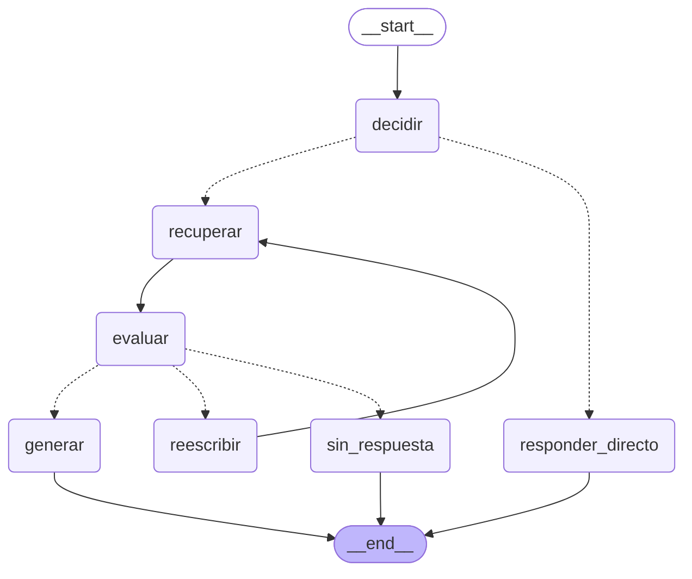

# rag-notas

Asistente de preguntas y respuestas sobre documentación técnica en español, construido con RAG (Retrieval-Augmented Generation): busca en los documentos los fragmentos relevantes para cada pregunta y responde a partir de ellos.

> Proyecto de aprendizaje personal, en desarrollo. Cada etapa se implementa primero sin frameworks para entender qué hace, y se mide antes de pasar a la siguiente.

**Estado actual:** ingesta, búsqueda vectorial, reranker, generación de respuestas con citas, una capa agéntica y correctiva con LangGraph y evaluación de recuperación y respuestas. La búsqueda híbrida (vectorial + BM25) está implementada y medida, pero desactivada por defecto porque no mejora. Tiene filtro por permisos en la búsqueda. Pendiente: prueba de prompt injection.

## Arquitectura

Dos formas de responder, que comparten la búsqueda (`retrieve.buscar`) y el prompt de generación:

- **Pipeline directo** (`generate.py`): búsqueda vectorial → reranker → LLM con citas.
- **Grafo** (`grafo.py`, LangGraph): decide si la pregunta necesita buscar, evalúa si lo recuperado es relevante y, si no lo es, reformula la pregunta una vez antes de responder "No lo tengo en la documentación."



Diagrama generado con `app.get_graph().draw_mermaid()` (`python scripts/dibujar_grafo.py`, también en [`docs/grafo.md`](docs/grafo.md)). Las flechas discontinuas son aristas condicionales.

## Corpus

20 documentos técnicos públicos en español (documentación de Kubernetes, Pro Git y MDN Web Docs), unas 50.000 palabras, con un conjunto de evaluación de 28 preguntas escritas a mano: comandos literales, cifras, una pregunta que necesita dos documentos, un documento de acceso restringido y 5 preguntas sin respuesta en el corpus. Detalles en [`docs/corpus.md`](docs/corpus.md); licencias en [`LICENCIAS.md`](LICENCIAS.md).

## Resultados

### Recuperación

Evaluada sobre las 23 preguntas del conjunto que tienen respuesta en el corpus. Un acierto es que alguno de los k primeros fragmentos recuperados sea del documento esperado y contenga el texto de la respuesta. Esta tabla y la de respuestas miden calidad, así que se calculan con acceso total (también lo restringido); el filtro por permisos se mide aparte, en [Seguridad](#seguridad). Al añadir el filtro se repitió la evaluación con acceso total y los puestos de las 23 preguntas salieron idénticos en las 4 configuraciones (`eval/resultados/2026-11-03_1040` a `_1046`).

| Configuración | Recall@1 | Recall@3 | Recall@5 | Recall@10 | Latencia media (CPU) |
|---|---|---|---|---|---|
| Solo vectorial | 0,57 | 0,87 | 0,91 | 0,91 | 0,12 s |
| Vectorial + reranker (25 candidatos) | 0,65 | 0,87 | 0,91 | 0,91 | 10,11 s |
| Híbrida (vectorial + BM25, RRF) | 0,52 | 0,83 | 0,83 | 0,91 | 0,12 s |
| Híbrida + reranker (25 candidatos) | 0,65 | 0,87 | 0,91 | 0,91 | 8,44 s |

Por tipo de pregunta (recall@5): las configuraciones con reranker y la solo vectorial sacan comandos literales 5/5, cifras 2/2, factuales 13/14 y multi-hop 0/1. La híbrida sin reranker baja a cifras 1/2 y factuales 12/14.

**Qué aporta el reranker:** sube el fragmento correcto al primer puesto en 6 preguntas, pero lo baja en otras 4 (de 1.º a 2.º en dos de ellas). Ganancia neta: 2 preguntas más con el fragmento correcto en primer lugar. No cambia el recall@5: los fallos están antes, en los candidatos que recibe.

**Qué fallos hay y por qué:**

- **"¿Cuál es la regla de oro del rebase?"** La traducción española de Pro Git no usa "rebase" ni "regla de oro", sino "reorganizar": *"Nunca reorganices confirmaciones que hayas enviado a un repositorio público"*. La búsqueda vectorial deja ese fragmento en el puesto 31, fuera de los 25 candidatos del reranker. Ni ampliando a 50 candidatos lo sube al top 10: es un problema de vocabulario de la pregunta, no de orden. Candidato a reescritura de la consulta.
- **"¿Qué tipo de base de datos usa Kubernetes para guardar los Secrets?"** Necesita combinar dos documentos (los Secrets se guardan en etcd; etcd es un almacén clave-valor). Una sola búsqueda no lo resuelve.

**Qué aporta la búsqueda híbrida: nada en este corpus.**

- **Con reranker, el resultado es idéntico**: el fragmento correcto queda en el mismo puesto en las 23 preguntas. BM25 añade candidatos, pero el reranker nunca los prefiere a los de la búsqueda vectorial. La diferencia de latencia (10,11 s frente a 8,44 s) no se debe a la híbrida: las dos pasan 25 candidatos al reranker, así que es variación entre ejecuciones.
- **Sin reranker, empeora**: recall@5 baja de 0,91 a 0,83. Mejora 2 preguntas de comandos (recuperar lo guardado con `git stash` y volver a una revisión anterior de un Deployment pasan del 2.º al 1.er puesto), pero empeora 7. BM25 premia palabras sueltas: en "¿Qué método HTTP usa el navegador en la verificación previa (preflight) de CORS?" el fragmento correcto pasa del 3.er al 7.º puesto.
- **Los comandos literales no la necesitaban**: la búsqueda vectorial ya los encontraba todos (5/5) en el 1.er o 2.º puesto. El modelo de embeddings capta bien `--amend`, `git stash` o `kubectl` porque aparecen escritos igual en la pregunta y en el texto.
- **No arregla la pregunta del rebase**: el fragmento correcto solo comparte con la pregunta las palabras "la" y "de", y BM25 lo deja en el puesto 305 de 610. Las palabras exactas no ayudan cuando el documento dice "reorganizar" y la pregunta, "rebase".

Por eso está desactivada por defecto (`HIBRIDA=false` en `config.py`; se activa con `HIBRIDA=true` en `.env` o `python retrieve.py --hibrida`). Con un corpus con más códigos, siglas o nombres propios que no aparezcan escritos igual en la pregunta, podría compensar; habría que medirlo.

### Respuestas: pipeline directo frente al grafo

Las 28 preguntas, con `qwen2.5:14b`. Aquí el recall@5 se mide sobre los fragmentos que de verdad recibe el LLM: en el grafo, los que superan la evaluación de relevancia.

| Configuración | Recall@5 | "No lo tengo" en las 5 sin respuesta | "No lo tengo" en las 23 con respuesta | Latencia media | Latencia mediana |
|---|---|---|---|---|---|
| Pipeline directo | 0,91 | 5/5 | 1/23 | 12,1 s | 12,2 s |
| Grafo, evaluación con reranker (umbral 0,5) | 0,87 | 5/5 | 2/23 | 14,7 s | 12,6 s |
| Grafo, evaluación con LLM juez | 0,87 | 5/5 | 2/23 | 17,4 s | 15,2 s |

**Ramas del grafo** (28 preguntas): con reranker, 23 acaban en `generar` y 5 en `sin_respuesta`, y 7 pasan por `reescribir`. Con LLM juez, 22 en `generar` y 6 en `sin_respuesta`, y 6 pasan por `reescribir`. Ninguna pregunta del conjunto va a `responder_directo`, y no hubo errores ni cortes por límite.

**Pregunta trampa** ("¿Cuál es la última versión estable de Kubernetes?", el modelo conoce una respuesta por su entrenamiento): en las tres configuraciones acaba en "No lo tengo en la documentación." En el grafo recorre `decidir → recuperar → evaluar → reescribir → recuperar → evaluar → sin_respuesta`, sin pasar por `responder_directo`.

**Latencia media por nodo** (de las trazas):

| Nodo | Con reranker | Con LLM juez |
|---|---|---|
| decidir | 0,57 s | 0,55 s |
| recuperar | 9,93 s | 10,06 s |
| evaluar | 0,00 s | 2,59 s |
| reescribir | 0,81 s | 0,49 s |
| generar | 1,85 s | 1,70 s |

Fragmentos medios que pasan la evaluación: de 5 a 2,17 con reranker y de 5 a 1,26 con LLM juez.

**Conclusiones:**

- **En este corpus, el grafo no mejora al pipeline directo.** El pipeline directo ya dice "No lo tengo" en las 5 preguntas sin respuesta, y el filtro de relevancia del grafo a veces descarta el fragmento bueno. Con reranker, en "¿Cómo veo qué borraría git clean sin borrar nada?" el fragmento con la respuesta queda por debajo de 0,5. Con LLM juez, en "¿Puedo guardar contraseñas en un ConfigMap?" el juez descarta los cinco fragmentos.
- **La reescritura no arregla la pregunta del rebase.** Una reformulación genérica no llega a "reorganizar".
- **Las diferencias de una pregunta no son significativas.** Entre dos ejecuciones idénticas del pipeline directo, con temperatura 0,1, los "No lo tengo" en preguntas con respuesta pasaron de 2/23 a 1/23.
- Lo que aporta el grafo y no mide este conjunto: no busca ni gasta tiempo con saludos (en las pruebas, una respuesta directa tarda ~1 s frente a ~12 s), y deja trazado por qué responde lo que responde.

**Primera versión del grafo, corregida antes de estos números.** El nodo `decidir` era un sí/no y mandó una pregunta técnica ("¿Cómo rehago la última confirmación…?") a `responder_directo`. Ahora el LLM clasifica en categorías explícitas y solo saludos, despedidas, agradecimientos y preguntas sobre la conversación van a `directo`; cualquier otra cosa busca. Además, el prompt de reescritura incluía un ejemplo sacado de una respuesta del conjunto de evaluación. Lo quité porque era sobreajuste. Los resultados de esa versión están en `eval/resultados/` (2026-10-24, 13:10-13:25).

Cada ejecución de la evaluación se guarda con fecha en `eval/resultados/`.

## Seguridad

### Filtro por permisos

Cada documento lleva en su frontmatter un nivel de `confidencialidad` (`publico` o `restringido`), que se copia a los metadatos de todos sus fragmentos. `06-k8s-secrets.md` está marcado como restringido a propósito, para probar el filtro.

- **El filtro va en la recuperación, no en el prompt.** `buscar()` recibe los niveles que puede ver quien pregunta y se los pasa a Chroma como filtro `where` dentro de la propia consulta. Lo que no se recupera no puede llegar al LLM. Pedirle al modelo que "no use los documentos restringidos" dependería de que obedezca, y una inyección de prompt podría convencerle de lo contrario: el LLM no es un control de acceso.
- **Por defecto, solo lo público** (mínimo privilegio). El valor por defecto está fijo en `config.py` y no en `.env`, para que una línea olvidada en la configuración no abra todo el corpus.
- **BM25 filtra también.** La búsqueda híbrida junta dos búsquedas: si solo filtrara la vectorial, el documento restringido entraría por la de palabras clave, y en la fusión RRF ya no se distinguiría de dónde vino. Por eso hay un índice BM25 por nivel de acceso, construido solo con los fragmentos permitidos: los restringidos no están en el índice público ni cuentan en sus estadísticas.
- **Falla en cerrado.** Un fragmento sin etiqueta de confidencialidad no lo ve nadie, y un nivel desconocido (por ejemplo, una errata como `"pubico"`) da error en vez de devolver una lista vacía sin avisar.
- **Tests sin modelos** (`tests/test_permisos.py`): con una colección de Chroma real en memoria, se pregunta con el texto literal del fragmento restringido y k mayor que el número de fragmentos, por las 6 vías (vectorial, BM25, híbrida y `buscar()` sin y con reranker). Con acceso público no sale nunca; con acceso total, sí. Si se quita el filtro, fallan 8 tests.

Medido con `python evaluate.py --permisos` (`eval/resultados/2026-11-03_1048_permisos.json`):

| Búsqueda (25 candidatos, las 28 preguntas) | Fragmentos de `06-k8s-secrets.md` | Preguntas en las que aparecen |
|---|---|---|
| Vectorial, acceso público | 0 | 0 de 28 |
| Vectorial, acceso total | 68 | 7 de 28 |
| Híbrida, acceso público | 0 | 0 de 28 |
| Híbrida, acceso total | 58 | 9 de 28 |

Con acceso total, el documento restringido aparece entre los candidatos de 7 a 9 preguntas, aunque solo una pregunta trata sobre él: sin filtro se colaría en respuestas a preguntas que no lo buscan.

| Pregunta 12: "¿Qué tamaño máximo puede tener un Secret?" | Acceso público | Acceso total |
|---|---|---|
| Pipeline directo | "No lo tengo en la documentación." (0 fragmentos restringidos) | Responde 1 MiB citando el documento restringido |
| Grafo (reranker, umbral 0,5) | "No lo tengo en la documentación." (0 fragmentos restringidos) | Responde 1 MiB citando el documento restringido |

Es una sola pregunta y una sola ejecución por caso: comprueba que el nivel de acceso llega de punta a punta, no es una medida estadística.

## Decisiones técnicas

| Decisión | Motivo |
|---|---|
| Embeddings `intfloat/multilingual-e5-large` en local | Documentos en español; los datos no salen de la máquina |
| Troceado en dos fases: por cabeceras Markdown y después en fragmentos de 800 caracteres con 100 de solape | Cada fragmento pertenece a una sola sección. El tamaño es un punto de partida, pendiente de comparar con otros |
| Ruta de secciones al inicio de cada fragmento (p. ej. `Pods > Uso de Pods`) | El fragmento conserva su contexto aunque se recupere suelto |
| Reranker cross-encoder `BAAI/bge-reranker-v2-m3` sobre 25 candidatos | +0,08 de recall@1 a cambio de ~8 s por consulta en CPU. Con GPU el coste bajaría mucho |
| LLM local `qwen2.5:14b` con Ollama, servido desde otro equipo de la red con GPU (RTX 4080) | Sin coste por consulta y los documentos no salen de la red local. El firewall solo admite conexiones del equipo de desarrollo, porque Ollama no tiene autenticación |
| Prompt que obliga a usar solo el contexto, con una frase fija para "no lo tengo" y citas `[n]` | Permitir explícitamente el "no lo sé" reduce las invenciones; las citas hacen la respuesta auditable. Las citas a fragmentos inexistentes se detectan en post-proceso |
| Capa agéntica y correctiva en un solo `StateGraph` de LangGraph | El flujo (decidir, evaluar, reintentar) queda explícito, se puede dibujar y se prueba nodo a nodo. Reutiliza la búsqueda y el prompt del pipeline directo, sin reimplementarlos |
| `decidir` con salida estructurada en categorías; solo las sociales van a `directo` | Ante la duda, buscar: responder un dato técnico de memoria es peor que tardar unos segundos más. Si el LLM falla al clasificar, también se busca |
| Evaluación de relevancia configurable: puntuación del reranker con umbral 0,5 o LLM juez sí/no | El reranker ya puntúa cada fragmento al buscar, así que filtrar no cuesta nada (0,00 s frente a 2,59 s del juez). 0,5 es la frontera de decisión de su salida (una probabilidad); no se calibra con 28 preguntas para no sobreajustar |
| Máximo 1 reescritura | Si una reformulación no encuentra nada relevante, lo más probable es que el corpus no tenga la respuesta; cada reintento cuesta ~10 s de búsqueda |
| Límites: 10 pasos de grafo, timeout por paso y por llamada al LLM | El camino más largo posible son 7 pasos; el límite corta cualquier bucle por error. Si se supera un límite, la respuesta es "No lo tengo" |
| Proveedor y modelo del LLM solo en `.env` | Cambiar de modelo no toca el código. Si faltan, el programa falla con un mensaje claro |
| Trazas en JSON por línea con ruta, reintentos, latencia por nodo y fragmentos antes/después de evaluar | Permite auditar cada respuesta. De la pregunta solo se guarda un hash y su longitud, no el texto |
| Dependencias del grafo inyectadas (LLM y búsqueda) | Los tests prueban el enrutado con funciones simuladas, sin Ollama ni modelos (36 tests en <1 s, contando los de RRF y los de permisos) |
| Búsqueda híbrida (BM25 + vectorial con Reciprocal Rank Fusion, k=60) antes del reranker, desactivada por defecto | Implementada y medida, pero no mejora (ver resultados). RRF combina puestos, no puntuaciones, porque las de BM25 y las del coseno no son comparables; k=60 es el valor del artículo original. Se mantiene en el código para poder medirla con otros corpus |
| Índice BM25 en memoria, construido con los mismos fragmentos de Chroma | Con 610 fragmentos, leerlos de Chroma y construir el índice tarda 0,08 s y no hay que mantener otro almacén. En producción usaría la búsqueda de texto completo de la base de datos (Postgres con `tsvector` y configuración en español) u OpenSearch, que se actualizan con cada documento y no ocupan memoria del proceso |
| Filtro por permisos en la búsqueda (`where` de Chroma sobre el metadato `confidencialidad`), por defecto solo `publico` | Lo que no se recupera no puede llegar al LLM. Filtrarlo en el prompt ("no uses los documentos restringidos") dependería de que el modelo obedezca, y el LLM no es un control de acceso. Ver [Seguridad](#seguridad) |
| Evaluación por contenido (`texto_esperado`), no por id de fragmento | Se puede cambiar el troceado sin rehacer el conjunto de evaluación |

## Stack

Python · ChromaDB · sentence-transformers · LangChain · LangGraph · Ollama · pytest

## Limitaciones

- Conjunto de evaluación pequeño (23 preguntas con respuesta): los números orientan, no son concluyentes.
- De las respuestas se mide si dicen "No lo tengo", no si su contenido es correcto (falta un juez de fidelidad al contexto).
- El conjunto no tiene saludos ni preguntas sobre la conversación, así que la rama `responder_directo` solo se ha probado a mano y en los tests.
- El cambio de `decidir` se hizo tras ver un fallo en este mismo conjunto de evaluación, que también se usa para medirlo.
- Los permisos son por documento y de dos niveles (`publico` / `restringido`), y quien llama declara su nivel: no hay autenticación de usuarios. En un sistema real, el nivel saldría de la identidad autenticada (p. ej. los grupos del usuario), nunca de lo que diga la petición.
- El LLM es un modelo abierto de 14B cuantizado a 4 bits: responde peor que los modelos comerciales grandes.
- Los modelos se ejecutan en CPU: la primera ingesta tarda varios minutos y el reranker añade unos 8 s por consulta.

## Ejecutarlo en local

```bash
git clone https://github.com/laloba04/rag-notas.git
cd rag-notas
python3 -m venv .venv && source .venv/bin/activate
pip install -r requirements.txt   # incluye torch para CPU; la primera vez descarga ~2 GB de modelo
cp .env.example .env             # dirección de Ollama y modelo
ollama pull qwen2.5:14b          # en el equipo que ejecute Ollama
python ingest.py                  # indexa los documentos de data/ en chroma/
python retrieve.py "¿Qué es un Pod?"               # búsqueda con reranker
python retrieve.py --sin-rerank "¿Qué es un Pod?"  # solo vectorial
python retrieve.py --hibrida "¿Qué es un Pod?"     # vectorial + BM25 y reranker
python generate.py "¿Qué es un Pod?"               # respuesta con citas (pipeline directo)
python grafo.py "¿Qué es un Pod?"                  # respuesta con el grafo
python generate.py --acceso=publico,restringido "¿Qué tamaño máximo puede tener un Secret?"  # ve también lo restringido (por defecto, solo lo público; vale igual en retrieve.py y grafo.py)
python evaluate.py                # tabla de recuperación, 4 configuraciones (~8 min en CPU)
python evaluate.py --grafo        # pipeline directo frente al grafo (~25 min)
python evaluate.py --permisos     # filtro por permisos: búsqueda y respuestas con acceso público y total
python -m pytest                  # tests del enrutado del grafo, sin LLM
```

## Estructura

```
ingest.py              troceado, embeddings e indexación en Chroma
retrieve.py            búsqueda vectorial, BM25, fusión RRF y reranking
generate.py            prompt, llamada al LLM y comprobación de citas
grafo.py               capa agéntica y correctiva con LangGraph, límites y trazas
config.py              proveedor y modelo del LLM (desde .env) y límites del grafo
evaluate.py            recuperación y respuestas sobre el conjunto de evaluación
tests/                 tests del grafo (LLM simulado), de la fusión RRF y del filtro por permisos
docs/grafo.md          diagrama del grafo
data/                  los 20 documentos del corpus
eval/golden_set.json   preguntas de evaluación
eval/resultados/       resultados de cada evaluación, con fecha
extra/                 documento para la prueba de prompt injection
scripts/               descarga y limpieza del corpus
```
